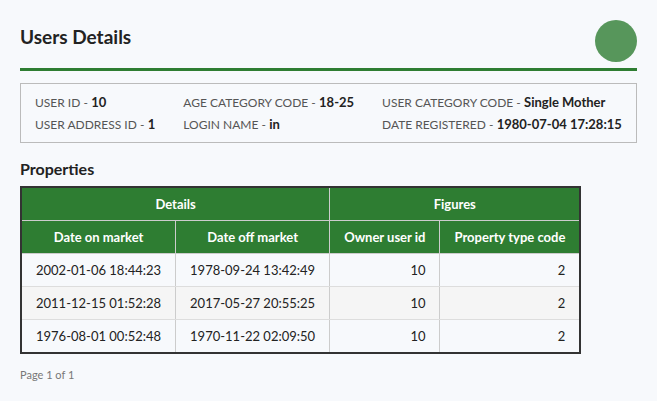
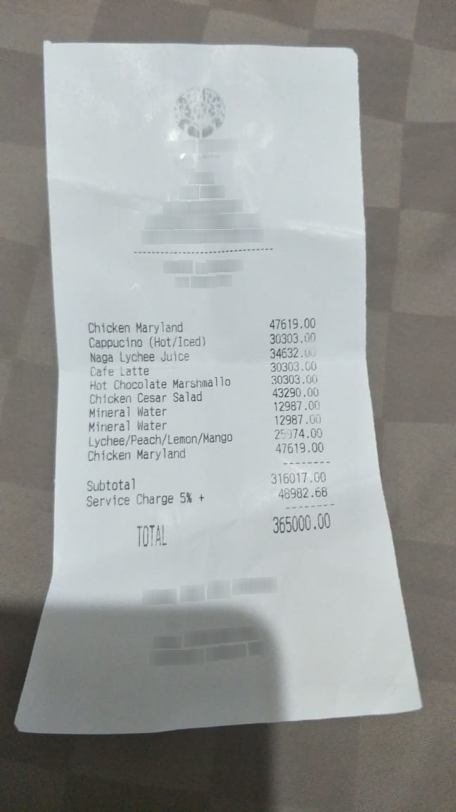

# pix2db

[](https://doi.org/10.21203/rs.3.rs-11467404/v1)

**Image → working SQLite database.** Give it a screenshot or photo of a table, form, invoice, receipt or
chart; get back `CREATE TABLE` + `INSERT` statements that actually run — with column types, primary keys,
foreign keys between related tables, and a verify/repair layer that tells you when something looks off.

[📄 Paper](https://doi.org/10.21203/rs.3.rs-11467404/v1) ·
[🤗 Model](https://huggingface.co/musapeker/pix2db-2b) ·
[🤗 Demo](https://huggingface.co/spaces/musapeker/pix2db) ·
[🤗 Dataset](https://huggingface.co/datasets/musapeker/pix2db-data) ·
[Open in Colab](https://colab.research.google.com/github/m-peker/pix2db/blob/main/notebooks/pix2db_colab.ipynb)

<p align="center"> </p>

```python
from pix2db import Pix2DB

model = Pix2DB.from_pretrained("musapeker/pix2db-2b")
db = model.extract("invoice.png")

print(db.sql)                      # schema + rows
db.tables                          # {"invoice": DataFrame, "line_items": DataFrame}
db.query("SELECT SUM(price) FROM line_items")
db.save("invoice.sqlite")          # a real SQLite file
db.warnings                        # e.g. "line_items.qty: 1 non-numeric value(s) in a INTEGER column"
```

```bash
pip install "git+https://github.com/m-peker/pix2db"
```

## Why

OCR → text → LLM pipelines lose table structure, and VLMs that output HTML or Markdown still leave you with
a *layout*, not a *database*. pix2db (2B parameters, Apache-2.0) is trained to turn the layout into a
relational schema:

| In the image | In the database |
|---|---|
| merged cell spanning 3 rows | value repeated in each of the 3 rows |
| two-level header ("Figures → Age") | single column `age` |
| `$1,250.00`, `(1,209)`, `5 Mar 2009` | `1250.0`, `-1209`, `'2009-03-05'` |
| invoice header + item table | two tables + `FOREIGN KEY` |
| "Total" row | not stored (derived) |
| bar / line / pie chart | category column + one column per series |

## Results

All systems get the same instruction; SQL outputs go through the same repair layer. *Table exact* = the
predicted table matches the gold table cell for cell. *F1* = cell-level F1 after name-agnostic table/column/row
alignment. *Recall* is used for receipts because a receipt can legitimately be stored with extra tables
(totals, payment).

| System | Synthetic test<br>table exact | Synthetic test<br>FK recall | PubTabNet<br>F1 | FinTabNet<br>F1 | CORD receipts<br>recall | Synthetic receipts<br>recall | **TabRecSet (unseen)**<br>F1 |
|---|---|---|---|---|---|---|---|
| **pix2db-2b** (ours) | **0.86** | **0.99** | **0.81** | **0.96** | **0.93** | **1.00** | 0.52 |
| Qwen3-VL-8B → SQL | 0.75 | 0.75 | 0.52 | 0.59 | 0.76 | 0.87 | 0.45 |
| Qwen3-VL-8B → HTML → pandas → SQLite | 0.47 | 0.00 | 0.78 | 0.87 | 0.44 | 0.38 | **0.58** |
| Qwen3-VL-4B → SQL | 0.66 | 0.25 | 0.48 | 0.48 | 0.79 | 0.77 | 0.38 |
| Qwen3-VL-2B → SQL (our base model) | 0.53 | 0.23 | 0.30 | 0.36 | 0.59 | 0.67 | 0.31 |

- **Synthetic test** (900 images): tables from Spider databases never used in training, rendered at six
  difficulty levels (clean, styled, merged cells / multi-level headers, documents with a foreign key,
  scanned/photographed, charts). The HTML pipeline is strong on flat tables but collapses on merged cells and
  documents and never recovers relationships.
- **PubTabNet / FinTabNet / CORD**: real images from the *validation/test* splits of datasets whose *train*
  splits were used for training — unseen images, familiar style.
- **TabRecSet (unseen)**: 150 English tables from a dataset never used in training (camera photos, scans,
  screenshots). pix2db is the best system that produces a database directly, but the 4× larger 8B model
  with an HTML pipeline is ahead on cell F1 here. An error analysis (see the paper) shows the gap is mostly
  reading accuracy on photographed text and row segmentation, not layout normalization. TabRecSet does not
  mark header rows, so the gold treats the first row as the header; this affects only a few key-value tables.

Per-level and per-system details: [`results/v2/`](results/v2/). On the synthetic test, pix2db gets
0.86–0.95 table exact on every layout level; charts are the weakest area (0.63 exact, 0.88 cell F1).

## Verify / repair layer

Every model output goes through deterministic checks before you see it ([`repair.py`](src/pix2db/repair.py)):
unescaped quotes, SQL keywords or free text used as column names (`# of sequences¹` → `of_sequences`), bare
composite values (`9 (8)`, `85.0 ± 10.8` → quoted text), duplicate primary keys, rows with missing trailing
cells and truncated output are repaired statement by statement, row by row; empty tables, values that
contradict their declared type, duplicate rows and broken foreign keys are reported as warnings.

## Training data

[`musapeker/pix2db-data`](https://huggingface.co/datasets/musapeker/pix2db-data), ~36.6k examples:
- 14k synthetic images from the 146 training databases of [Spider](https://yale-lily.github.io/spider)
  (CC BY-SA 4.0), rendered with HTML/CSS (17 fonts, styles, merged cells, forms, scan artefacts) and matplotlib;
  the gold database is exact by construction.
- 3k synthetic receipts.
- 10k real tables from [PubTabNet](https://github.com/ibm-aur-nlp/PubTabNet) and 8k from
  [FinTabNet](https://developer.ibm.com/exchanges/data/all/fintabnet/) train splits (CDLA-Permissive-1.0),
  converted from their HTML annotations ([`htmltable.py`](src/pix2db/htmltable.py)).
- 795 real receipt photos from [CORD](https://github.com/clovaai/cord) train (CC BY 4.0), seen twice.

Model: Qwen3-VL-2B-Instruct + LoRA (r=64, language model only), 1 epoch, ~6 h on one A40.

## Reproduce

```bash
pip install -e ".[train]" && playwright install chromium
bash scripts/setup_pod.sh                 # fresh GPU box: venvs, fonts, Spider
python scripts/pull_data.py               # or regenerate: scripts/make_set.py, make_real_train.py
python scripts/train.py --config configs/train_2b_v2.yaml
bash scripts/eval_v2.sh                   # vLLM inference for all systems + scoring
```

## Limitations

- Handwriting is not covered; very long tables (> ~30 rows) and dense financial statements with section rows
  are under-represented in training.
- Charts without value labels are read approximately (scored with a 4% tolerance).
- Column and table *names* are the model's choice; evaluation is name-agnostic.

## License

Code and model weights: Apache-2.0 (base model Qwen3-VL-2B-Instruct is Apache-2.0). Training data are derived
from Spider (CC BY-SA 4.0), PubTabNet and FinTabNet (CDLA-Permissive-1.0) and CORD (CC BY 4.0); the TabRecSet
evaluation subset is CC BY 4.0.

## Related work

OptiSQL (arXiv 2601.13695) generates a SQL *query* from a clean table image; MTabVQA (arXiv 2506.11684) does
visual QA over rendered tables. pix2db reconstructs the *database itself* — once — so any number of queries run
deterministically on real SQLite.

## Citation

> Musa Peker. *PIX2DB: Reconstructing Executable Relational Databases from Document Images with a 2B Vision-Language Model*. Research Square preprint, 2026. [doi:10.21203/rs.3.rs-11467404/v1](https://doi.org/10.21203/rs.3.rs-11467404/v1)
> (preprint, not peer-reviewed)

```bibtex
@misc{peker2026pix2db,
  title        = {PIX2DB: Reconstructing Executable Relational Databases from Document Images with a 2B Vision-Language Model},
  author       = {Peker, Musa},
  year         = {2026},
  howpublished = {Research Square preprint},
  doi          = {10.21203/rs.3.rs-11467404/v1},
  url          = {https://doi.org/10.21203/rs.3.rs-11467404/v1}
}
```
